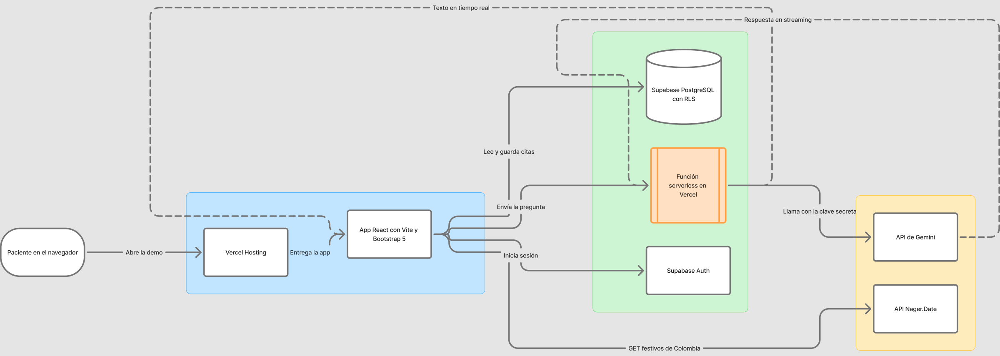

# Mi Cita

Aplicación web para agendar citas médicas en una EPS en pocos pasos y saber con certeza que la cita quedó confirmada. Continúa el prototipo diseñado en el módulo 1 de Diseño de Interfaces de Usuario (Fundación Universitaria Konrad Lorenz).

Mi Cita es un proyecto académico genérico: no corresponde a ninguna EPS real.

> Proyecto en construcción. Este README se completa a medida que avanzan las funcionalidades.

## Integrantes

- Omar Eduardo Cardozo Pachón (trabajo individual)

## Tecnologías

- React 19 con Vite 8
- Bootstrap 5.3

(Se completa con las versiones de Supabase, la API de festivos, Gemini y Vercel al integrarlas.)

## Instalación y ejecución en local

Requisitos: Node.js 20 o superior y npm.

```bash
git clone <URL del repositorio>
cd mi-cita-m2
npm install
cp .env.example .env   # y llena los valores
npm run dev
```

## Arquitectura



Fondo azul: frontend. Fondo verde: servicios cloud. Fondo amarillo: API externas. Detalle de cada capa en la [planificación](docs/planificacion.md#4-arquitectura-técnica).

## Base de datos y seguridad

La base de datos está en Supabase (PostgreSQL). El esquema y los datos de ejemplo están versionados en [`supabase/migrations/`](supabase/migrations/).

- Todas las tablas tienen RLS (seguridad por fila) activada. Los catálogos (especialidades, sedes y agenda) solo se pueden leer, y solo con sesión iniciada. Cada usuario ve, crea y cancela únicamente sus propias citas.
- Cancelar una cita cambia su estado a "Cancelada"; no la borra, para conservar el historial.
- Un índice único impide que dos usuarios confirmen el mismo espacio de agenda.
- La función `horarios_disponibles` es `SECURITY DEFINER` a propósito: necesita saber qué espacios están ocupados por citas de otros usuarios, que RLS no deja ver. Solo devuelve el id y la hora del espacio libre, nunca datos de otras personas, y no la pueden ejecutar visitantes sin sesión. El asesor de seguridad de Supabase la reporta como advertencia; se revisó y se mantiene por esta razón.

## Documentación

- Planificación del proyecto: [docs/planificacion.md](docs/planificacion.md)

## Pendiente

Enlace a la demo, funcionalidades implementadas, pruebas, créditos de API y servicios, y declaración de uso de inteligencia artificial.
