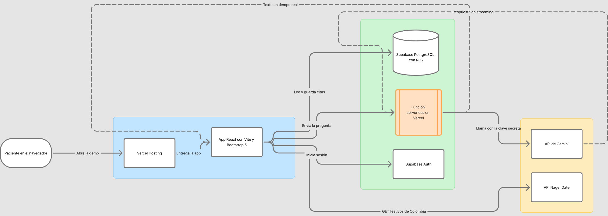

# Planificación del proyecto Mi Cita (versión web)

Diseño de Interfaces de Usuario, módulo 2. Evaluación abierta: "Construyendo interfaces inteligentes".
Autor: Omar Eduardo Cardozo Pachón. Trabajo individual.
Fecha: 7 de noviembre de 2026

## 1. Problema

Este proyecto continúa el problema identificado en el módulo 1, como lo permite la guía de la actividad.

Enunciado (módulo 1): "Un afiliado a una EPS que necesita atención médica necesita agendar su cita desde el celular en pocos pasos y saber con certeza que quedó confirmada, porque las aplicaciones actuales lo devuelven al menú, lo remiten a una línea telefónica o no le muestran el estado de su solicitud."

Evidencia: en el módulo 1 se analizaron 600 reseñas recientes de Google Play de tres aplicaciones de EPS en Colombia; 388 tenían una o dos estrellas. Los temas de queja más frecuentes fueron el ingreso y la sesión (74 reseñas aprox.), no ver el estado del trámite (26) y que agendar no avanza o remite al teléfono (25).

En el módulo 1 el resultado fue un prototipo en Figma. En el módulo 2 se construye la aplicación web funcional: los datos se guardan de verdad, el usuario inicia sesión y la cita queda registrada.

Mi Cita es una aplicación genérica: no corresponde a ninguna EPS real. Las sedes, especialidades, horarios y usuarios de prueba son inventados.

## 2. Público objetivo

Afiliados a una EPS en Colombia que agendan citas desde el celular. Se mantienen las dos personas del módulo 1:

| Persona | Perfil | Necesidad principal |
|---|---|---|
| Laura Gómez | 34 años, auxiliar contable, alta familiaridad con la tecnología | Agendar para ella y su hijo en menos de 2 minutos, sin llamar |
| Jorge Rincón | 63 años, pensionado, baja familiaridad con la tecnología, ve mal de cerca | Pedir sus controles sin ayuda, leer sin esfuerzo y saber que la cita quedó |

## 3. Funcionalidades

### Obligatorias

| Id | Funcionalidad | Paso de la guía que cubre |
|---|---|---|
| F1 | Registro e inicio de sesión con correo y contraseña, con sesión que se mantiene abierta | Paso 6 (autenticación) |
| F2 | Agendar una cita en cuatro pasos: para quién es, especialidad, sede con día y hora, revisión y confirmación | Pasos 3, 4 y 6 |
| F3 | Mis citas: listado de las citas del usuario con su estado escrito (Confirmada, Cancelada), y cancelación con confirmación previa | Pasos 4 y 6 |
| F4 | Días festivos de Colombia: el calendario no ofrece citas en festivos, con datos de una API REST pública | Paso 5 |
| F5 | Asistente para preparar la cita: el paciente pregunta, por ejemplo, si debe ir en ayunas o qué documentos llevar, y recibe una respuesta en lenguaje sencillo que aparece en tiempo real. Aviso visible de que es una inteligencia artificial y de que no da diagnósticos | Paso 7 |
| F6 | Retroalimentación al usuario: indicadores de carga, mensajes de éxito y mensajes de error que explican qué pasó y qué hacer | Pasos 4 y 5 |
| F7 | Interfaz responsiva y accesible: celular, tableta y escritorio; contraste AA; foco visible; etiquetas en todos los campos | Paso 3 |

### Opcionales (si el tiempo alcanza)

| Id | Funcionalidad |
|---|---|
| O1 | Grupo familiar en el perfil (agendar para un hijo o un padre) |
| O2 | Botón "Aa Letra más grande" (decisión del módulo 1 pensada en Jorge) |
| O3 | Atajo "Repetir última cita" |
| O4 | Pantalla "Sin agenda" con alternativas cuando no hay cupos |

## 4. Arquitectura técnica

| Capa | Tecnología | Responsabilidad | Por qué esta y no otra |
|---|---|---|---|
| Frontend | React con Vite | Pantallas, componentes, estado y navegación | Es la que enseña el módulo (temática 2). Vue también lo permite la guía, pero no hay material del curso |
| Estilos | Bootstrap 5, con los colores del prototipo del módulo 1 como variables CSS | Diseño responsivo y componentes visuales | Trae menús, formularios, alertas y cuadrícula responsiva listos, lo que acelera a un desarrollador individual. Tailwind daría más fidelidad al diseño de Figma, pero exige construir cada pieza |
| Servicio cloud | Supabase (autenticación y base de datos PostgreSQL) | Usuarios, citas, sedes, especialidades y horarios; reglas de seguridad por fila (RLS) para que cada usuario solo vea y cambie sus citas | Es el que enseña el módulo (temática 4). Firebase también lo permite la guía, pero el curso solo cubre su hosting |
| API REST externa | Nager.Date (`https://date.nager.at/api/v3/PublicHolidays/{año}/CO`) | Lista de festivos de Colombia para bloquear esos días en el calendario | Pública, sin clave y relacionada con el problema. Verificada el 7 de noviembre de 2026 |
| Inteligencia artificial | API de Gemini (Google) | Responder las preguntas del asistente de preparación | [DATO A VERIFICAR: condiciones del nivel gratuito] |
| Función serverless | Función de Vercel | Recibe la pregunta del frontend, llama a Gemini con la clave guardada en el servidor y devuelve la respuesta en streaming | La guía exige que la clave no quede en el frontend |
| Despliegue | Vercel, conectado al repositorio de GitHub | Publicar la demo y la función serverless en un solo lugar | [DATO A VERIFICAR: límites del plan gratuito] |

Diagrama de arquitectura (elaborado en FigJam, la misma herramienta de los diagramas del módulo 1):

Leyenda de capas: fondo azul, capa frontend; fondo verde, capa de servicios cloud; fondo amarillo, capa de API externas. Las flechas continuas son solicitudes y las punteadas son respuestas que llegan en streaming. La aplicación del navegador nunca habla directamente con Gemini: lo hace a través de la función serverless, que es la única que conoce la clave.

Regla de seguridad: ninguna clave secreta va en el código del frontend. La clave de Gemini solo existe como variable de entorno en Vercel. El frontend usa la clave pública (anon) de Supabase, que está pensada para el navegador y queda protegida por las reglas RLS. El archivo `.env` está en `.gitignore` y el repositorio incluye un `.env.example` sin valores reales.

## 5. Gestión del proyecto

Trabajo individual: Omar Eduardo Cardozo Pachón es responsable de todas las funcionalidades.

Flujo de ramas (Gitflow):

- `main`: versión entregada; al final lleva el tag `v1.0.0`.
- `develop`: integración de funcionalidades terminadas.
- Una rama `feature/...` por funcionalidad, unida a `develop` con un pull request: `feature/estructura-base`, `feature/autenticacion`, `feature/agendar-cita`, `feature/mis-citas`, `feature/festivos-api`, `feature/asistente-ia`, `feature/accesibilidad`, `feature/despliegue`.

Mensajes de commit en el formato que sugiere la guía, por ejemplo `feat: agrega inicio de sesión con Supabase`.

## 6. Plan de pruebas

Antes de entregar se prueba la demo publicada en Chrome, Firefox y un celular real. Los resultados (qué se probó, dónde y qué pasó) quedan en una tabla del README con capturas.
